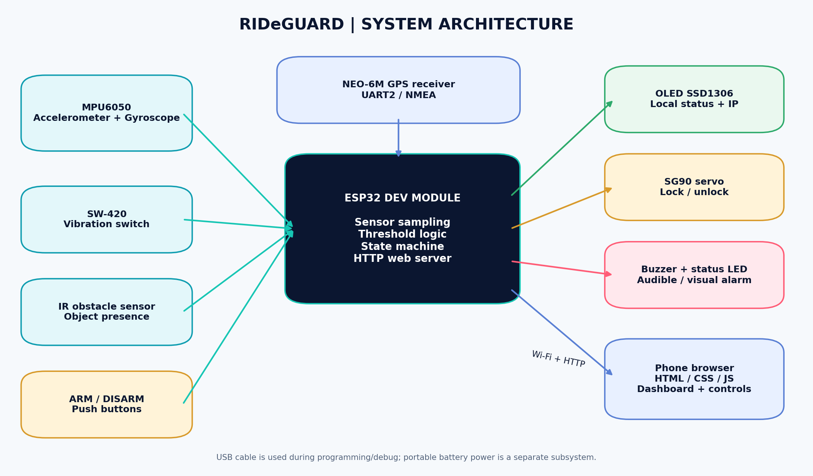
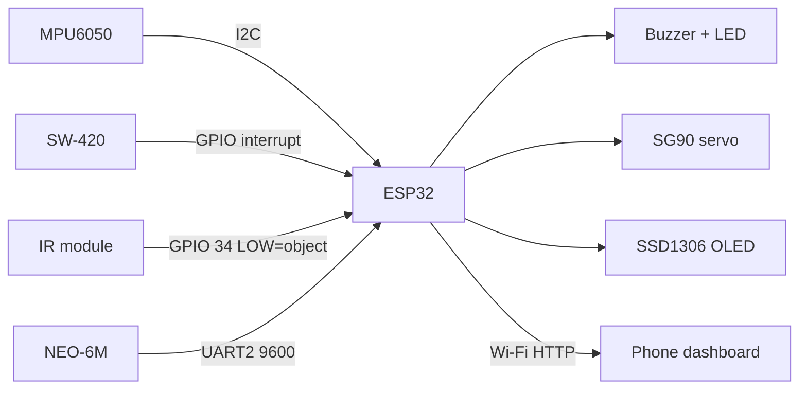

# RIDeGUARD

RIDeGUARD is an ESP32-based smart bicycle security prototype developed in the Arduino framework and C++. It combines an MPU6050, SW-420 vibration sensor, IR obstacle sensor, NEO-6M GPS, SSD1306 OLED, servo, buzzer, status LED, and an ESP32-hosted phone dashboard.

> **Prototype status:** RIDeGUARD demonstrates multi-sensor security logic and servo actuation. The servo is not a certified bicycle lock, and the project has not been validated as a reliable theft-prevention system. The reed switch has been removed and is not a current firmware input.



## Key features

- MPU6050 motion and gyroscope readings with startup and arming-time calibration
- SW-420 interrupt edge counting and 400 ms detection hold windows
- IR obstacle detection configured for a LOW-active output
- Warning and confirmed-theft state logic with 4-second arming settle
- 0° servo unlock and 90° servo lock commands
- OLED status, sensor, security, GPS, alert, and IP screens
- Buzzer and status LED feedback
- NEO-6M NMEA parsing with explicit live-fix versus demo-data fallback
- ESP32 Wi-Fi Station dashboard and unauthenticated local control routes
- Physical ARM/DISARM buttons and browser-based test tools

## Repository layout

```text
RideGuard/
├── README.md
├── rideguard.ino
└── docs/
    └── images/
```

## Hardware

| Component | Purpose |
|---|---|
| ESP32 Dev Module | Main controller and Wi-Fi web server |
| MPU6050 | I2C acceleration, temperature, and rotation sensing |
| SSD1306 OLED, 128×64 | Local status and diagnostic display |
| SW-420 vibration module | Digital vibration edge events |
| IR obstacle sensor | Object/clear indication at its active output |
| SG90 servo | Demonstration lock/unlock actuator |
| Buzzer | Audible warning/alarm feedback |
| Status LED | Armed, arming, alarm, and idle indication |
| ARM/DISARM buttons | Local physical controls |
| NEO-6M GPS | NMEA location parsing |

## Pin mapping

| Device | ESP32 pin | Notes |
|---|---:|---|
| MPU6050 SDA | GPIO 21 | Address `0x68`; shares I²C with OLED |
| MPU6050 SCL | GPIO 22 | 400 kHz I²C clock |
| OLED SDA | GPIO 21 | SSD1306 address `0x3C` |
| OLED SCL | GPIO 22 | Shared I²C bus |
| SW-420 OUT | GPIO 27 | Interrupt on both edges |
| IR OUT | GPIO 34 | Input-only; firmware treats LOW as object detected |
| Servo signal | GPIO 18 | ESP32Servo control; 0° unlock, 90° lock |
| Buzzer | GPIO 25 | HIGH enables the digital buzzer output |
| Status LED | GPIO 2 | Active HIGH in firmware |
| ARM button | GPIO 32 | INPUT_PULLUP; press connects to GND |
| DISARM button | GPIO 33 | INPUT_PULLUP; press connects to GND |
| GPS TXD from module | GPIO 16 (ESP32 RX2) | UART2 RX |
| GPS RXD to module | GPIO 17 (ESP32 TX2) | UART2 TX |

Use the pin and power details below, and verify every breakout-board voltage against its datasheet before supplying power.

## Firmware behavior

- Sensors are sampled approximately every 100 ms. Vibration edges are counted every sample window; at least 2 edges are required for the vibration hold.
- Motion threshold: `0.35 g` deviation from the MPU-calibrated acceleration baseline.
- Strong motion threshold: `0.70 g`.
- Gyro threshold: `150 °/s`; strong rotation: `300 °/s`.
- Sensor hold time: 400 ms, allowing separate indicators to correlate.
- IR requires 2 consecutive positive firmware samples before `irDetected` becomes true.
- ARMED state starts a 4-second `ARMING` window. Sensor evaluation is paused, a servo movement lock command is sent, and a fresh MPU baseline is acquired at the end.
- Vibration or motion or IR alone produces a warning. Confirmed combinations, strong motion, or strong rotation trigger theft alert.
- A theft alert holds until the DISARM action. The servo remains at the armed command angle.

## Arduino IDE setup

1. Install the latest stable Arduino IDE.
2. Install Espressif **esp32** boards support and select **ESP32 Dev Module** (classic ESP32, not S3).
3. Connect the ESP32 and select the correct COM port.
4. Install the libraries below through **Sketch > Include Library > Manage Libraries** or Library Manager.
5. Open `rideguard.ino`; compile and upload before making private network changes.

Required libraries:

- `WiFi`, `WebServer`, `Wire`, `HardwareSerial` from Arduino-ESP32
- `ESP32Servo` by madhephaestus
- `Adafruit GFX Library`
- `Adafruit SSD1306`
- `TinyGPSPlus`

## Wi-Fi and dashboard access

The sketch uses station mode, a hard-coded Wi-Fi SSID/password, and a configured static IP. The current source contains a local demonstration credential and static addressing values. Do not reproduce or publish them; review them and replace them locally before deploying or sharing the repository.

A safe private-review configuration is:

1. Edit the local firmware copy and replace the network values with the intended private network.
2. Prefer an Arduino configuration header excluded by `.gitignore`, such as `secrets.h`, for future development.
3. Do not use a production or privileged network password for the prototype.
4. Use DHCP first while learning; static IP is optional and may conflict if the address is already assigned.
5. After upload, read the serial monitor for the actual connected IP and open it from a phone on the same reachable network.

The dashboard is HTTP on port 80 and is not an internet service. At present it has no authentication.

## HTTP routes

| Route | Method in firmware | Purpose | Response |
|---|---|---|---|
| `/` | GET (served directly by browser navigation) | Embedded dashboard | HTML/CSS/JavaScript |
| `/api` | GET by `setInterval(..., 1000)` | Poll sensor and security telemetry | JSON |
| `/arm` | GET | Enter ARMING, command servo lock, and schedule settling/calibration | Plain text `ARMING` |
| `/disarm` | GET | Disarm, clear alerts, and command servo unlock | Plain text `DISARMED` |
| `/test` | GET | Start a 5-second continuous test alarm state; sensor blanking is also enabled | Plain text `TEST ALARM` |
| `/selftest` | GET | Run a disarmed-only self-test and return the result | Plain text result |

The browser polls `/api` once per second. To call a control route, open or fetch the route from the local network. Commands are unauthenticated GET requests; avoid exposing port 80 outside a trusted network.

### `/api` JSON fields

`armed`, `arming`, `theft`, `alarm`, `warn`, `lock`, `motion`, `vibration`, `gyro`, `ir`, `ax`, `ay`, `az`, `gx`, `gy`, `gz`, `movement`, `temp`, `sat`, `lat`, `lng`, `alt`, `gpsfix`, `gpschars`, `mpu`, `oled`, `vibtotal`, `rssi`, `up`, `ssid`, `ip`, and `event`.

## Self-test and sensor checks

For `/selftest`, the system must first be disarmed. The route:

- tests MPU6050 communication and accelerometer magnitude;
- reports OLED status;
- pulses LED/buzzer and moves the servo lock then unlock;
- requests a tap and hand wave over IR for 5 seconds;
- checks SW-420 edges, motion, gyro, and IR change;
- checks for GPS NMEA characters and Wi-Fi connection.

The response is an automated diagnostic report, not a physical PASS certificate: LED, buzzer, servo movement, and sensor action must be visually confirmed.

Before a public demonstration, record the sensor checks in a separate test log and mark every physical result as observed, failed, or still requiring verification.

## GPS behavior

When a TinyGPSPlus location is valid and younger than 5 seconds, latitude, longitude, altitude, and satellite data are treated as live. Otherwise the dashboard and OLED show `DEMO DATA`. Demo coordinates must never be presented as an actual location. The fallback currently reports a fixed reference with small simulated bounds and `sat=1` while the real fix is unavailable.

## Architecture



The state transitions and sensor combination are described above and reflected directly in the firmware.

## Verification status

| Status | Meaning |
|---|---|
| Implemented in source | Confirmed by firmware review |
| Partially implemented | Present, but physical or security behavior remains unverified |
| Planned | Not present in the sketch or requires future work |

No current hardware test result is recorded as passed unless it is supplied by later physical evidence.

## Limitations

- The dashboard is local-network only and has no authentication.
- The current SW-420 is a threshold-adjusted digital switch, not a calibrated vibration measurement.
- MPU sensitivity and thresholds depend on mounting, orientation, and handling.
- The IR sensor reports object presence, not identity.
- The demo servo is not a hardened lock and has no confirmed lock-position feedback.
- The NEO-6M may take time or be unable to acquire a fix indoors; fallback data is synthetic.
- Recharge topology, protection, charging, weatherproofing, field endurance, and enclosure strength are not confirmed.
- No GSM/SMS, cloud service, push notification, secure communication, or real-time tracking exists in this firmware.

## Troubleshooting

For troubleshooting, isolate one subsystem at a time: verify Wi-Fi/IP, I²C addresses, MPU calibration, IR polarity, SW-420 sensitivity, GPS data, servo power, and serial upload settings. A servo current spike should be suspected first when a reset occurs during locking or unlocking.

## Visual assets

The available report graphics include architecture, security logic, pin connections, I²C topology, web architecture, power concept, dashboard concept, and no-wheel demonstration concepts in `docs/images/`. Some are illustrations and not photographs of final tested hardware.

## Acknowledgments

**Owner and creator: Divyam Madan**.

The implementation builds on the Arduino framework and these libraries:

- [Espressif Arduino Core](https://github.com/espressif/arduino-esp32)
- [ESP32Servo](https://github.com/madhephaestus/ESP32Servo)
- [Adafruit GFX Library](https://github.com/adafruit/Adafruit-GFX-Library)
- [Adafruit SSD1306 Library](https://github.com/adafruit/Adafruit_SSD1306)
- [TinyGPSPlus](https://github.com/mikalhart/TinyGPSPlus)

## Contributing and review

This repository is intended for private academic review until Divyam explicitly chooses to publish it. Before publication, rotate any local Wi-Fi credential, remove private static addresses and network-specific assumptions, review Git history, and complete the hardware test matrices.

Do not commit or push without explicit review. No commit, push, release, or publication is performed by this documentation preparation workflow.
